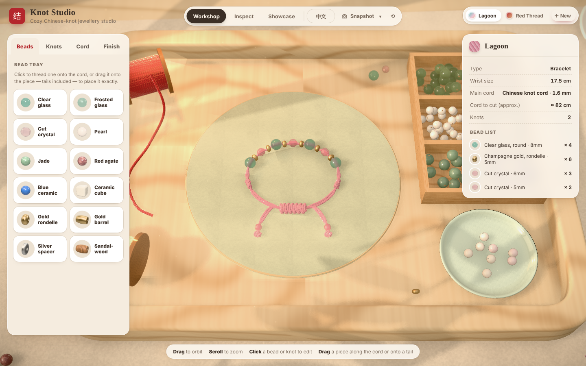
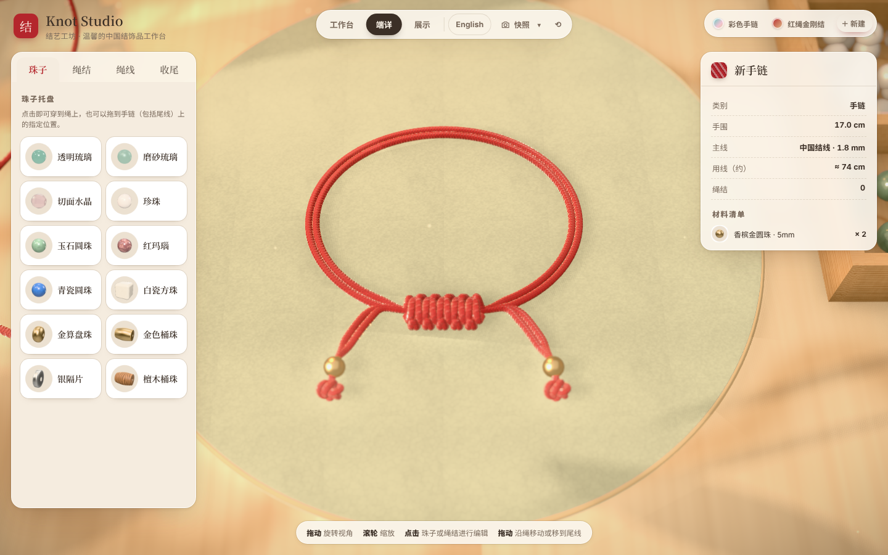
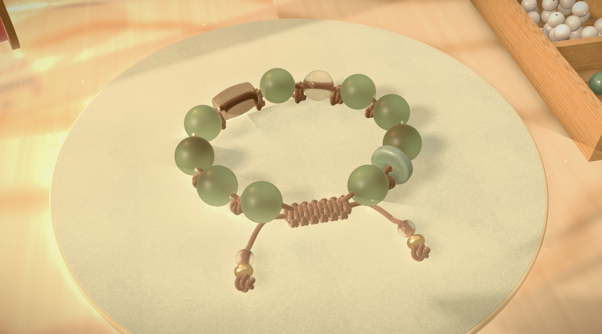

# Knot Studio · 结艺工坊

A small, cozy 3D Chinese-knot jewellery workspace built with **TypeScript + Three.js + React Three Fiber**.

```bash
npm install
npm run dev        # http://localhost:5173
npm run build      # type-check + production build into dist/
```




## What you can do

| Action | How |
|---|---|
| Orbit / zoom | drag / scroll (360° in Showcase, above-the-table in Workshop / Inspect) |
| Select a bead, knot or tassel | click it (warm halo + lift) |
| Slide a piece | drag it — it stays threaded and can move between the main cord and the clasp tails |
| Add beads / knots | click a component card in the left tray, or **drag the card onto the piece** (tails included) |
| Edit a bead | colour, material, shape, size — choosing pearl forces a round pearl, crystal forces faceted |
| Edit a knot | style, repeat (where allowed), colour, thread; book steps shown under each knot |
| Tassel 流苏 | in the Knots tab: fringe length, silk colour, band colour; one per spot (repeat 1), use Duplicate |
| Main cord | thread type, colour, thickness, single/double strand, wearable length |
| Finish 收尾 | sliding knot (tails default 2.5 cm, beads on each tail), button & loop |
| New piece | **＋ New 新建** starts a fresh bracelet |
| Language | 中文 / English toggle in the top bar — the UI shows one language at a time (remembered per browser) |
| Snapshot 快照 | camera button saves the current view + full design; ▾ opens the list to reload a design or download the image |
| Views | `1` Workshop 工作台 · `2` Inspect 端详 · `3` Showcase 展示 |

## Code structure

```
src/
  data/              design data
    types.ts         Design, BeadItem, KnotItem, CordSpec …
    materials.ts     Material Library (bead PBR presets, cord/thread presets, palettes)
    catalog.ts       component catalogue: bead shapes, knot styles, endings, presets
  lib/
    layout.ts        design → placement: cord paths per jewellery type (loop / open drop /
                     clasp tails), arc-length positions, overlap relaxation, cord height, gathering
    textures.ts      procedural canvas textures (wood, linen, braid relief, bead detail)
  three/
    beadGeometry.ts  unit bead meshes (lathe / rounded box), threading axis = +X
    knotGeometry.ts  knots as strand centre-lines (+ per-point tutorial step tags) → tubes
    tasselGeometry.ts  流苏: folded head, wrapped band, fanned fringe
    materialFactory.ts  Material Library → cached MeshPhysicalMaterial
  scene/
    Experience.tsx   <Canvas>, workshop composition, automation hooks
    Lighting.tsx     sun, lamp, ambient, Lightformer environment, showcase key/fill
    Effects.tsx      post stack (N8AO, DOF, bloom, grade, vignette, tone mapping)
    CameraRig.tsx    orbit + fly-to between views
    ShowcaseBackdrop.tsx
    jewelry/         Bracelet, Cord, Piece (bead/knot + interaction), Ending (clasps)
    workshop/        Tray, Props (box, dish, spools, scissors, lamp, teacup), Room (table,
                     wall, shadow casters, light shafts, dust)
  state/store.ts     zustand store: design, undo/redo history, selection, drag, view, new piece
  ui/                Library (tray), Inspector, 3D thumbnails (thumbs.ts), swatches & icons
```

## Rendering & material choices
- **Beads.** One geometry per silhouette, many materials. `MeshPhysicalMaterial` with transmission + IOR +
  attenuation for glass, crystal (flat-shaded facets + dispersion + iridescence), jade/agate (partial
  transmission, short attenuation → milky glow), pearl (sheen + iridescence + clearcoat), glazed ceramic
  (clearcoat + speckle), wood (sheen + grain). Clear glass is tinted lightly so the cord inside stays visible.
- **Cords.** Tubes along the bracelet path with procedural bump maps: herringbone braid for 中国结线 (5号/72号),
  fine twist for 玉线, smooth twist for 蜡线, fuzzy twist for 棉线, metallic for 金线, and a gold filament baked
  into the albedo/metal maps for 加金线. Anisotropy + sheen give the satin cord its soft sheen. Two strands
  lie side by side and gather/rise to pass through each bead's centre.
- **Knots** are generated from strand centre-lines (diamond 金刚结, square 平结 and spiral 单向平结, snake 蛇结,
  snake-belly braid 蛇腹结, double connection 双联结, button knot 纽扣结). Because each knot is a
  set of curves, round 2 can animate the cord path step by step (draw-on along the curve, slow-mo, reverse),
  following the Macrame911 / Knots 3D idea that diagrams come from data rather than from images.
- **Showcase** lifts the bracelet off the tray, tilts it toward the camera, fades in a bright cream sweep,
  adds a soft studio key/fill and slowly turns — the "hold it up to the light" moment, without a hand.

## Reference

Each knot in `data/catalog.ts` carries the step text from 《中国结一本通》, and `three/knotGeometry.ts`
builds its strands as data:

- **平结 / 单向平结** — built from the steps: cord *a* stays on the front and zig-zags across as the bars
  (a 挑 b, 压垂线), cord *b* stays behind and wraps forward at each edge (穿过左圈 / 穿过右圈). The two-direction
  version alternates sides so it lies flat; the one-direction version twists into a spiral. Control points are
  tagged with step numbers for the tutorial.
- **金刚结, 蛇结, 蛇腹结, 双联结** — stylised strand paths that match the finished look; they still need to be
  re-authored step by step.
- Not in the tray yet (code kept in `knotGeometry.ts`): 二回盘长结, 双钱结, 酢浆草结, 纽扣结 (纽扣结 is used by the
  button-and-loop clasp).
- **流苏** — the book's method: a bundle folded over the hanging cord, bound with wrapped thread under the fold.
